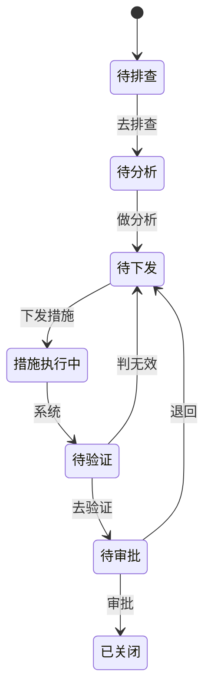
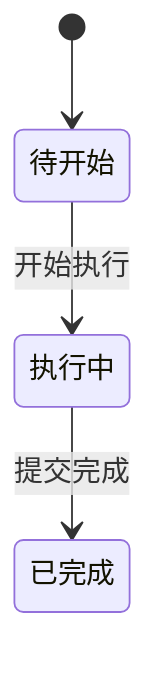

# 新锂想质量管理系统 · 产品需求文档

> 生成源：example-02-accident.proto.json @ sha256:8e6c19d8917f47d8（build_prd v1.2，2026-11-10 12:39）
> 由 `scripts/build_prd.py` 从 `proto.json` 生成；字段字典与契约同源，改契约前请勿手改本文。
> 版本 0.4.0 ｜ 生成于 -

## 1 背景与目标

### 1.1 要解决的问题

- 详情页只读，推进动作全部在列表页
  - 理由：同一条命令若详情页和列表页都能执行，状态机有两个触发点，四眼校验、幂等与操作日志都要写两遍
- 原因分析用抽屉而不是弹框
  - 理由：5Why 需要一边看排查结论一边填，字段 7 个，弹框放不下也不方便对照
- 新建报告用独立页面
  - 理由：事故经过是大段文本，加上临时处置，弹框里滚动不现实

### 1.2 目标与度量

- 端：pc
- 页面：4 个 ｜ 命令：12 条 ｜ 业务字段：51 个

### 1.3 非目标

- 未决（-）：
- 未决（-）：

### 1.4 角色

| 角色 | 说明 |
|---|---|
| 安全员 | 现场 3 人轮班；排查人与验证人必须是不同的人，由同一角色下的人区分，不另设岗位 |
| 质量工程师 | 原因分析责任人；不能同时做效果验证（四眼原则） |
| 质量经理 | 负责下发整改措施；与执行人分离 |
| 责任部门主管 | 措施执行人，按措施单逐条执行，不操作事故主单 |
| 厂长 | 关闭审批；不得与质量经理为同一人，否则审批变成自签 |

## 2 业务流程与状态机

### 2.1 业务流程

- 事故报告生命周期：待排查 → 待分析 → 待下发 → 措施执行中 → 待验证 → 待审批 → 已关闭
- 整改措施单生命周期：待开始 → 执行中 → 已完成
### 2.2 状态机

### 2.3 按钮可用性矩阵

| 命令 | 角色 | 可用状态 | 不可用策略 | 提示 |
|---|---|---|---|---|
| 新建报告 | 安全员 | 不限 | disabled | 无前置状态限制；同一天同部门可重复报，不做唯一性校验 |
| 去排查 | 安全员 | 待排查 | disabled | 仅「待排查」可排查 |
| 做分析 | 质量工程师 | 待分析 | disabled | 仅「待分析」可分析；未排查不能跳步分析 |
| 下发措施 | 质量经理 | 待下发 | disabled | 仅「待下发」可下发措施；措施未下发前不进入执行 |
| 去验证 | 安全员 | 待验证 | disabled | 仅「待验证」可验证；措施未全部完成不能验证 |
| 判无效 | 安全员 | 待验证 | disabled | 仅「待验证」可判定；无效将退回「待分析」重新分析原因 |
| 审批 | 厂长 | 待审批 | disabled | 仅「待审批」可审批 |
| 退回 | 厂长 | 待审批 | disabled | 仅「待审批」可退回；退回后重新进入「待分析」 |
| 开始执行 | 责任部门主管 | 待开始 | disabled | 仅「待开始」可开始执行 |
| 提交完成 | 责任部门主管 | 执行中 | disabled | 仅「执行中」可提交完成 |
| 导出 | 质量经理 | 不限 | disabled | 导出不受单据状态限制；无数据时导出空表并提示 |
| 提交报告 | 安全员 | 不限 | disabled | 提交后即进入「待排查」；重复提交以幂等拦下并提示已提交 |

### 2.4 业务规则（guards）

| 规则 | 挂哪条命令 | 不满足时的界面表现 | 可判定形式 |
|---|---|---|---|
| 未完成过程排查不能提交原因分析 | 做分析 | 本单还没完成过程排查，不能做原因分析。 | `accident.status == 'patrolled'` |
| 措施未全部完成不能进入效果验证 | 去验证 | 还有 {未完成措施数} 项措施未完成，不能验证。 | `measures.all(status == 'done')` |
| 原因分析人与效果验证人不得为同一人 | 去验证 | 验证人不能与原因分析人是同一个人（四眼原则）。 | `analyze.actor != verify.actor` |
| 审批关闭需厂长角色，且不得与下发措施人为同一人 | 审批 | 审批人不能与下发措施的人相同（四眼原则）。 | `approve.actor != issue.actor` |

- 角色限制不写在本列：权限不足时入口不出现（R-06），本列只写"条件不满足"的提示。
- 若某条规则依赖"人是否相同"，只能在提交时校验（选人之前无法预判），由开发在提交接口校验并返回本条 message；原型不预置灰。
- 与 `from` 的分工：`from` 判"状态是否允许"，本列说明"为什么不允许"，两层不合并。

## 3 功能说明

### 3.1 页面地图

- 事故报告台账（pg-acc-ledger，/quality/accident/ledger）
- 我的待办（pg-acc-mine，/workbench/accident-todo）
- 事故报告详情（pg-acc-detail，/quality/accident/detail/:id）
- 新建事故报告（pg-acc-new，/quality/accident/new）

### 3.2 事故报告台账

**3.2.1 页面职责**

- 任务：质量经理按状态推进事故报告：下发措施、审批关闭，并掌握全厂事故进度
- 角色：安全员、质量工程师、质量经理、责任部门主管、厂长
- 完成条件：本页无「待下发 / 待审批」停留超过 2 天的报告

**3.2.2 功能逻辑**

| 按钮 | 角色 | 前置状态 | 后置状态 | 幂等 | 失败处理 |
|---|---|---|---|---|---|
| 新建报告 | 安全员 | 不限 | — | — | 无前置状态限制；同一天同部门可重复报，不做唯一性校验 |
| 导出 | 质量经理 | 不限 | — | — | 导出不受单据状态限制；无数据时导出空表并提示 |
| 去排查 | 安全员 | 待排查 | 待分析 | 按实体状态机 | 仅「待排查」可排查 |
| 做分析 | 质量工程师 | 待分析 | 待下发 | 按实体状态机 | 仅「待分析」可分析；未排查不能跳步分析 |
| 下发措施 | 质量经理 | 待下发 | 措施执行中 | 按实体状态机 | 仅「待下发」可下发措施；措施未下发前不进入执行 |
| 去验证 | 安全员 | 待验证 | 待审批 | 按实体状态机 | 仅「待验证」可验证；措施未全部完成不能验证 |
| 判无效 | 安全员 | 待验证 | 待下发 | 按实体状态机 | 仅「待验证」可判定；无效将退回「待分析」重新分析原因 |
| 审批 | 厂长 | 待审批 | 已关闭 | 按实体状态机 | 仅「待审批」可审批 |
| 退回 | 厂长 | 待审批 | 待下发 | 按实体状态机 | 仅「待审批」可退回；退回后重新进入「待分析」 |

**3.2.3 交互逻辑**

- __row_click → pg-acc-detail（navigate）
- n-table__act_view → pg-acc-detail（navigate）
- n-table__act_issue → cap-issue-measure（submit）
- n-table__act_approve → cap-approve（submit）
- n-table__act_reject → cap-reject（submit）
- n-toolbar__act_new → cap-new（submit）
- n-toolbar__act_export → cap-export（submit）
- n-filter__act_search → None（setState）

**3.2.4 校验规则**

- 到场时间：必填，到场时间不得早于事故发生时间
- 排查结论：必填，从结论字典中选择；选择「管理缺陷」时须在勘查情况中写明依据
- 现场勘查情况：必填，写现场勘查看到的事实，不写判断；不少于 30 字
- 责任部门：必填，从组织架构中选择责任部门
- 是否已停机：必填，是否已停线停机；选「是」后须在临时处置中写明停线时间
- 分析方法：必填，注明分析方法（5Why/鱼骨图等）
- 直接原因：必填，写直接触发因素，不少于 20 字
- 根本原因：必填，写可整改的根本原因；不得写「管理不到位」这类无法落措施的结论
- Why1 为什么厚度不均：按 5Why 逐层追问，每层不超过 120 字，不得跳层
- Why2 为什么会有划痕：按 5Why 逐层追问，每层不超过 120 字，不得跳层
- Why3 为什么异物没被清理：按 5Why 逐层追问，每层不超过 120 字，不得跳层
- Why4 为什么没有这个动作：按 5Why 逐层追问，每层不超过 120 字，不得跳层
- 措施内容：必填，措施须可验收：写清做什么、做到什么程度，不少于 20 字
- 责任部门：必填，从组织架构中选择承接措施的部门
- 责任人：必填，从人员字典选择；不得填部门代替个人
- 完成期限：必填，不得早于今天；超期需在说明中写延期理由
- 验收标准：必填，写可判定的验收标准（数量/状态/文件），不写「整改完成」
- 验证方式：必填，注明验证方式（现场复核/记录抽查/试运行）
- 验证结论：必填，从结论字典选择；判定无效须转「退回」并写无效依据
- 验证依据：必填，写验证依据的编号或附件名，可追溯
- 无效依据：必填，写清哪一条不满足验收标准，不少于 20 字
- 审批意见：必填，写明同意/不同意及理由；不同意须指明退回环节
- 是否纳入月度安环通报：必填，是否纳入月度安环通报；选「是」后由安环汇总
- 退回原因：必填，写退回原因与需补充的材料，不少于 20 字

**3.2.5 异常分支**

- g-1：未完成过程排查不能提交原因分析（`accident.status == 'patrolled'`）
- g-2：措施未全部完成不能进入效果验证（`measures.all(status == 'done')`）
- g-3：原因分析人与效果验证人不得为同一人（`analyze.actor != verify.actor`）
- g-4：审批关闭需厂长角色，且不得与下发措施人为同一人（`approve.actor != issue.actor`）

### 3.3 我的待办

**3.3.1 页面职责**

- 任务：安全员与责任主管从待办直接推进手头的事故排查、原因分析、措施执行与效果验证
- 角色：安全员、质量工程师、责任部门主管
- 完成条件：本页「剩余 ≤ 0 天」的待办清零

**3.3.2 功能逻辑**

| 按钮 | 角色 | 前置状态 | 后置状态 | 幂等 | 失败处理 |
|---|---|---|---|---|---|
| 导出 | 质量经理 | 不限 | — | — | 导出不受单据状态限制；无数据时导出空表并提示 |
| 去排查 | 安全员 | 待排查 | 待分析 | 按实体状态机 | 仅「待排查」可排查 |
| 做分析 | 质量工程师 | 待分析 | 待下发 | 按实体状态机 | 仅「待分析」可分析；未排查不能跳步分析 |
| 去验证 | 安全员 | 待验证 | 待审批 | 按实体状态机 | 仅「待验证」可验证；措施未全部完成不能验证 |
| 判无效 | 安全员 | 待验证 | 待下发 | 按实体状态机 | 仅「待验证」可判定；无效将退回「待分析」重新分析原因 |
| 开始执行 | 责任部门主管 | 待开始 | 执行中 | 按实体状态机 | 仅「待开始」可开始执行 |
| 提交完成 | 责任部门主管 | 执行中 | 已完成 | 按实体状态机 | 仅「执行中」可提交完成 |

**3.3.3 交互逻辑**

- n-table__act_patrol → cap-patrol（submit）
- n-table__act_analyze → cap-analyze（submit）
- n-table__act_verify → cap-verify-pass（submit）
- n-table__act_verify_fail → cap-verify-fail（submit）
- n-table__act_start → cap-start-measure（submit）
- n-table__act_finish → cap-finish-measure（submit）
- n-filter__act_search → None（setState）

**3.3.4 校验规则**

- 执行计划：必填，写执行步骤与完成时点，不少于 20 字
- 实际完成时间：必填，不得晚于当前时间，且不得早于措施下发时间
- 完成证据：必填，照片/记录编号至少一项；无证据不予验收
- 说明：可空；有延期或变更时写原因，不超过 200 字

### 3.4 事故报告详情

**3.4.1 页面职责**

- 任务：让任何角色在一页内看清这张事故报告的全部事实与处理轨迹，不在本页做任何推进
- 角色：安全员、质量工程师、质量经理、厂长、责任部门主管
- 完成条件：看完无需回退即可判断这张单据卡在哪一步、缺什么

**3.4.2 交互逻辑**

- n-status → pg-acc-ledger（navigate）

### 3.5 新建事故报告

**3.5.1 页面职责**

- 任务：安全员在现场把事故经过、损失、涉及人员一次填清并提交，进入待排查
- 角色：安全员
- 完成条件：报告已提交且状态为「待排查」

**3.5.2 功能逻辑**

| 按钮 | 角色 | 前置状态 | 后置状态 | 幂等 | 失败处理 |
|---|---|---|---|---|---|
| 提交报告 | 安全员 | 不限 | 待排查 | 按实体状态机 | 提交后即进入「待排查」；重复提交以幂等拦下并提示已提交 |

**3.5.3 交互逻辑**

- n-toolbar-2__act_submit → cap-submit-report（submit）
- n-toolbar-2__act_draft → None（toast）

**3.5.4 校验规则**

- 事故发生时间：必填，不得晚于当前时间；精确到分钟，与现场记录一致
- 发生部门：必填，从组织架构中选择发生部门；跨部门事故选主要责任车间
- 事故类型：必填，按设备失效/操作违规/物料异常/环境因素/管理缺陷单选
- 事故等级：必填，按损失与影响分级；「较大」及以上进入厂长审批
- 涉及人员：参与人员用顿号分隔；无人员受伤填「无」，不得留空
- 损失工时(h)：保留 1 位小数，单位小时；不足 0.5 小时按 0.5 计
- 事故经过：必填，按时间顺序写：几点发现、看到什么、做了什么处置，不少于 50 字
- 临时处置：写已采取的临时措施与隔离范围；未处置填「未处置」并说明原因

## 4 字段字典

### 4.1 字段主档

| 字段 | key | 来源 | 去向 |
|---|---|---|---|
| 事故编号 | accNo | 系统生成 · SG-{yyyyMM}-{3 位流水}，按部门月度连续，提交时生成 | 事故报告 · 事故编号 |
| 发生部门 | dept | 组织架构 · 外部字典 | 事故报告 · 发生部门 |
| 事故等级 | level | 事故报告 · 事故等级（取值字典） | 事故报告 · 事故等级 |
| 事故类型 | type | 事故报告 · 事故类型（取值字典） | 事故报告 · 事故类型 |
| 发生时间 | at | 事故报告主表 | 事故报告 · 发生时间 |
| 报告人 | reporter | 事故报告主表 | 事故报告 · 报告人 |
| 报告状态 | accStatus | 事故报告 · 当前状态（取值字典） | 不落库（纯展示/计算/筛选） |
| 停留天数 | stay | 计算（口径：当前时间 − 最近一次状态迁移时间，按自然日向上取整） | 不落库（纯展示/计算/筛选） |
| 措施条数 | measureCount | 计算（口径：统计该事故下未关闭的措施条数） | 不落库（纯展示/计算/筛选） |
| 发生地点 | place | 事故报告主表 | 事故报告 · 发生地点 |
| 涉及人员 | people | 事故报告主表 | 事故报告 · 涉及人员 |
| 损失工时 | loss | 事故报告主表 | 事故报告 · 损失工时 |
| 事故经过 | story | 事故报告主表 | 事故报告 · 事故经过 |
| 临时处置 | temp | 事故报告主表 | 事故报告 · 临时处置 |
| 排查人 | patrolBy | 事故报告主表 | 事故报告 · 排查人 |
| 到场时间 | arriveAt | 事故报告主表 | 事故报告 · 到场时间 |
| 排查结论 | patrolResult | 事故报告 · 排查结论（取值字典） | 事故报告 · 排查结论 |
| 责任部门 | patrolDept | 组织架构 · 外部字典 | 事故报告 · 责任部门 |
| 现场勘查情况 | scene | 事故报告主表 | 事故报告 · 现场勘查情况 |
| 是否已停机 | stopLine | 事故报告主表 | 事故报告 · 是否已停机 |
| 分析方法 | tool | 事故报告主表 | 事故报告 · 分析方法 |
| 分析人 | analyzeBy | 事故报告主表 | 事故报告 · 分析人 |
| 直接原因 | directCause | 事故报告主表 | 事故报告 · 直接原因 |
| 根本原因 | rootCause | 事故报告主表 | 事故报告 · 根本原因 |
| Why 链条 | whyChain | 计算（口径：按 why1→why4 顺序拼接，空层跳过） | 不落库（纯展示/计算/筛选） |
| Why1 | why1 | 事故报告主表 | 事故报告 · Why1 |
| Why2 | why2 | 事故报告主表 | 事故报告 · Why2 |
| Why3 | why3 | 事故报告主表 | 事故报告 · Why3 |
| Why4 | why4 | 事故报告主表 | 事故报告 · Why4 |
| 措施编号 | measureNo | 措施单 | 不落库（纯展示/计算/筛选） |
| 措施内容 | content | 措施单 | 整改措施单 · 措施内容 |
| 责任人 | owner | 措施单 | 整改措施单 · 责任人 |
| 完成期限 | due | 措施单 | 整改措施单 · 完成期限 |
| 措施状态 | measureStatus | 整改措施单 · 措施状态（取值字典） | 不落库（纯展示/计算/筛选） |
| 责任部门（措施） | measureDept | 组织架构 · 外部字典 | 整改措施单 · 责任部门 |
| 验收标准 | acceptance | 措施单 | 整改措施单 · 验收标准 |
| 验证方式 | verifyWay | 措施单 | 整改措施单 · 验证方式 |
| 验证结论 | verifyResult | 措施单 | 整改措施单 · 验证结论 |
| 验证依据 | evidence | 措施单 | 整改措施单 · 验证依据 |
| 无效依据 | invalidReason | 措施单 | 整改措施单 · 无效依据 |
| 执行计划 | plan | 措施单 | 整改措施单 · 执行计划 |
| 实际完成时间 | doneAt | 措施单 | 整改措施单 · 实际完成时间 |
| 完成证据 | proof | 措施单 | 整改措施单 · 完成证据 |
| 说明 | note | 措施单 | 整改措施单 · 说明 |
| 审批意见 | conclusion | 事故报告主表 | 事故报告 · 审批意见 |
| 是否纳入月度安环通报 | monthlyReport | 事故报告主表 | 事故报告 · 是否纳入月度安环通报 |
| 退回原因 | rejectReason | 事故报告主表 | 事故报告 · 退回原因 |
| 单据编号 | docNo | 措施单 | 不落库（纯展示/计算/筛选） |
| 待办事项 | todo | 措施单 | 不落库（纯展示/计算/筛选） |
| 待办类型 | todoKind | 整改措施单 · 待办类型（取值字典） | 不落库（纯展示/计算/筛选） |
| 剩余天数 | daysLeft | 计算（口径：要求完成日期 − 今天，按自然日向下取整） | 不落库（纯展示/计算/筛选） |

### 4.2 事故报告台账

**4.2.1 本页取数链路**

| 数据源 | 类型 | 取值 | 喂给哪些字段 | 兜底 | 说明 |
|---|---|---|---|---|---|
| ds-serial | system | accNo | 事故编号 | - |  |
| ds-org | dict | 组织架构 | 发生部门、责任部门、责任部门（措施） | 组织架构取不到时允许手填并标记待同步 | 组织架构由 HR 系统维护，本系统只读；接口未定，先按部门名取 |
| ds-acc-level | dict | accident.level | 事故等级 | - |  |
| ds-acc-type | dict | accident.type | 事故类型 | - |  |
| ds-accident | entity | accident | 发生时间、报告人、到场时间、现场勘查情况、是否已停机、分析方法、直接原因、根本原因、Why1、Why2、Why3、Why4、审批意见、是否纳入月度安环通报、退回原因 | 无账号班组长由安全员代录 | 事故报告主表 |
| ds-acc-status | dict | accident.status | 报告状态 | - |  |
| ds-stay | calc | stayDays | 停留天数 | 已关闭单据显示总周期 |  |
| ds-measure-count | calc | measureCount | 措施条数 | 无措施显示 0 |  |
| ds-patrol-result | dict | accident.patrolResult | 排查结论 | - |  |
| ds-measure | entity | measure | 措施内容、责任人、完成期限、验收标准、验证方式、验证结论、验证依据、无效依据 | - | 措施单 |

**4.2.2 本页渲染位速查**

| 位置 | 文案 | 引用字段 | 形态 | 本处口径 |
|---|---|---|---|---|
| filter / n-filter | 事故编号 | 事故编号（accNo） | 字段筛选 | 按该字段值筛选 |
| filter / n-filter | 发生部门 | 发生部门（dept） | 字段筛选 | 按该字段值筛选 |
| filter / n-filter | 事故等级 | 事故等级（level） | 字段筛选 | 按该字段值筛选 |
| filter / n-filter | 发生日期 | 条件筛选（不指向字段） | 条件筛选 | 按发生时间区间筛选，含首尾当天 |
| column / n-table | 事故编号 | 事故编号（accNo） | 展示 | — |
| column / n-table | 事故类型 | 事故类型（type） | 展示 | — |
| column / n-table | 发生部门 | 发生部门（dept） | 展示 | — |
| column / n-table | 等级 | 事故等级（level） | 展示 | — |
| column / n-table | 发生时间 | 发生时间（at） | 展示 | — |
| column / n-table | 报告人 | 报告人（reporter） | 展示 | — |
| column / n-table | 当前状态 | 报告状态（accStatus） | 展示 | — |
| column / n-table | 停留(天) | 停留天数（stay） | 展示 | — |
| column / n-table | 措施 | 措施条数（measureCount） | 展示 | — |
| dialog / cap-patrol | 到场时间 | 到场时间（arriveAt） | 录入 | 必填，到场时间不得早于事故发生时间 |
| dialog / cap-patrol | 排查结论 | 排查结论（patrolResult） | 录入 | 必填，从结论字典中选择；选择「管理缺陷」时须在勘查情况中写明依据 |
| dialog / cap-patrol | 现场勘查情况 | 现场勘查情况（scene） | 录入 | 必填，写现场勘查看到的事实，不写判断；不少于 30 字 |
| dialog / cap-patrol | 责任部门 | 责任部门（patrolDept） | 录入 | 必填，从组织架构中选择责任部门 |
| dialog / cap-patrol | 是否已停机 | 是否已停机（stopLine） | 录入 | 必填，是否已停线停机；选「是」后须在临时处置中写明停线时间 |
| dialog / cap-analyze | 分析方法 | 分析方法（tool） | 录入 | 必填，注明分析方法（5Why/鱼骨图等） |
| dialog / cap-analyze | 直接原因 | 直接原因（directCause） | 录入 | 必填，写直接触发因素，不少于 20 字 |
| dialog / cap-analyze | 根本原因 | 根本原因（rootCause） | 录入 | 必填，写可整改的根本原因；不得写「管理不到位」这类无法落措施的结论 |
| dialog / cap-analyze | Why1 为什么厚度不均 | Why1（why1） | 录入 | 按 5Why 逐层追问，每层不超过 120 字，不得跳层 |
| dialog / cap-analyze | Why2 为什么会有划痕 | Why2（why2） | 录入 | 按 5Why 逐层追问，每层不超过 120 字，不得跳层 |
| dialog / cap-analyze | Why3 为什么异物没被清理 | Why3（why3） | 录入 | 按 5Why 逐层追问，每层不超过 120 字，不得跳层 |
| dialog / cap-analyze | Why4 为什么没有这个动作 | Why4（why4） | 录入 | 按 5Why 逐层追问，每层不超过 120 字，不得跳层 |
| dialog / cap-issue-measure | 措施内容 | 措施内容（content） | 录入 | 必填，措施须可验收：写清做什么、做到什么程度，不少于 20 字 |
| dialog / cap-issue-measure | 责任部门 | 责任部门（措施）（measureDept） | 录入 | 必填，从组织架构中选择承接措施的部门 |
| dialog / cap-issue-measure | 责任人 | 责任人（owner） | 录入 | 必填，从人员字典选择；不得填部门代替个人 |
| dialog / cap-issue-measure | 完成期限 | 完成期限（due） | 录入 | 必填，不得早于今天；超期需在说明中写延期理由 |
| dialog / cap-issue-measure | 验收标准 | 验收标准（acceptance） | 录入 | 必填，写可判定的验收标准（数量/状态/文件），不写「整改完成」 |
| dialog / cap-verify-pass | 验证方式 | 验证方式（verifyWay） | 录入 | 必填，注明验证方式（现场复核/记录抽查/试运行） |
| dialog / cap-verify-pass | 验证结论 | 验证结论（verifyResult） | 录入 | 必填，从结论字典选择；判定无效须转「退回」并写无效依据 |
| dialog / cap-verify-pass | 验证依据 | 验证依据（evidence） | 录入 | 必填，写验证依据的编号或附件名，可追溯 |
| dialog / cap-verify-fail | 无效依据 | 无效依据（invalidReason） | 录入 | 必填，写清哪一条不满足验收标准，不少于 20 字 |
| dialog / cap-approve | 审批意见 | 审批意见（conclusion） | 录入 | 必填，写明同意/不同意及理由；不同意须指明退回环节 |
| dialog / cap-approve | 是否纳入月度安环通报 | 是否纳入月度安环通报（monthlyReport） | 录入 | 必填，是否纳入月度安环通报；选「是」后由安环汇总 |
| dialog / cap-reject | 退回原因 | 退回原因（rejectReason） | 录入 | 必填，写退回原因与需补充的材料，不少于 20 字 |

**4.2.3 逐位说明**

#### field-pg-acc-ledger-n-filter-accNo 事故编号

- 形态：字段筛选
- 筛选口径：按该字段值筛选
- 业务字段：事故编号（accNo）
- 来源：系统生成 · SG-{yyyyMM}-{3 位流水}，按部门月度连续，提交时生成
- 去向：事故报告 · 事故编号

#### field-pg-acc-ledger-n-filter-dept 发生部门

- 形态：字段筛选
- 筛选口径：按该字段值筛选
- 业务字段：发生部门（dept）
- 来源：组织架构 · 外部字典
- 去向：事故报告 · 发生部门

#### field-pg-acc-ledger-n-filter-level 事故等级

- 形态：字段筛选
- 筛选口径：按该字段值筛选
- 业务字段：事故等级（level）
- 来源：事故报告 · 事故等级（取值字典）
- 去向：事故报告 · 事故等级

#### field-pg-acc-ledger-n-filter-range 发生日期

- 形态：条件筛选
- 筛选口径：按发生时间区间筛选，含首尾当天
- 业务字段：条件筛选，不指向字段

#### field-pg-acc-ledger-n-table-accNo 事故编号

- 形态：展示
- 空值显示：—
- 业务字段：事故编号（accNo）
- 来源：系统生成 · SG-{yyyyMM}-{3 位流水}，按部门月度连续，提交时生成
- 去向：事故报告 · 事故编号

#### field-pg-acc-ledger-n-table-type 事故类型

- 形态：展示
- 空值显示：—
- 业务字段：事故类型（type）
- 来源：事故报告 · 事故类型（取值字典）
- 去向：事故报告 · 事故类型

#### field-pg-acc-ledger-n-table-dept 发生部门

- 形态：展示
- 空值显示：—
- 业务字段：发生部门（dept）
- 来源：组织架构 · 外部字典
- 去向：事故报告 · 发生部门

#### field-pg-acc-ledger-n-table-level 等级

- 形态：展示
- 空值显示：—
- 业务字段：事故等级（level）
- 来源：事故报告 · 事故等级（取值字典）
- 去向：事故报告 · 事故等级

#### field-pg-acc-ledger-n-table-at 发生时间

- 形态：展示
- 空值显示：—
- 业务字段：发生时间（at）
- 来源：事故报告主表
- 去向：事故报告 · 发生时间

#### field-pg-acc-ledger-n-table-reporter 报告人

- 形态：展示
- 空值显示：—
- 业务字段：报告人（reporter）
- 来源：事故报告主表
- 去向：事故报告 · 报告人

#### field-pg-acc-ledger-n-table-status 当前状态

- 形态：展示
- 空值显示：—
- 业务字段：报告状态（accStatus）
- 来源：事故报告 · 当前状态（取值字典）
- 去向：不落库（纯展示/计算/筛选）

#### field-pg-acc-ledger-n-table-stay 停留(天)

- 形态：展示
- 空值显示：—
- 业务字段：停留天数（stay）
- 来源：计算（口径：当前时间 − 最近一次状态迁移时间，按自然日向上取整）
- 去向：不落库（纯展示/计算/筛选）

#### field-pg-acc-ledger-n-table-measure 措施

- 形态：展示
- 空值显示：—
- 业务字段：措施条数（measureCount）
- 来源：计算（口径：统计该事故下未关闭的措施条数）
- 去向：不落库（纯展示/计算/筛选）

#### field-pg-acc-ledger-cap-patrol-arriveAt 到场时间

- 形态：录入
- 校验规则：必填，到场时间不得早于事故发生时间
- 业务字段：到场时间（arriveAt）
- 来源：事故报告主表
- 去向：事故报告 · 到场时间

#### field-pg-acc-ledger-cap-patrol-patrolResult 排查结论

- 形态：录入
- 校验规则：必填，从结论字典中选择；选择「管理缺陷」时须在勘查情况中写明依据
- 业务字段：排查结论（patrolResult）
- 来源：事故报告 · 排查结论（取值字典）
- 去向：事故报告 · 排查结论

#### field-pg-acc-ledger-cap-patrol-scene 现场勘查情况

- 形态：录入
- 校验规则：必填，写现场勘查看到的事实，不写判断；不少于 30 字
- 业务字段：现场勘查情况（scene）
- 来源：事故报告主表
- 去向：事故报告 · 现场勘查情况

#### field-pg-acc-ledger-cap-patrol-duty 责任部门

- 形态：录入
- 校验规则：必填，从组织架构中选择责任部门
- 业务字段：责任部门（patrolDept）
- 来源：组织架构 · 外部字典
- 去向：事故报告 · 责任部门

#### field-pg-acc-ledger-cap-patrol-stopLine 是否已停机

- 形态：录入
- 校验规则：必填，是否已停线停机；选「是」后须在临时处置中写明停线时间
- 业务字段：是否已停机（stopLine）
- 来源：事故报告主表
- 去向：事故报告 · 是否已停机

#### field-pg-acc-ledger-cap-analyze-tool 分析方法

- 形态：录入
- 校验规则：必填，注明分析方法（5Why/鱼骨图等）
- 业务字段：分析方法（tool）
- 来源：事故报告主表
- 去向：事故报告 · 分析方法

#### field-pg-acc-ledger-cap-analyze-direct 直接原因

- 形态：录入
- 校验规则：必填，写直接触发因素，不少于 20 字
- 业务字段：直接原因（directCause）
- 来源：事故报告主表
- 去向：事故报告 · 直接原因

#### field-pg-acc-ledger-cap-analyze-root 根本原因

- 形态：录入
- 校验规则：必填，写可整改的根本原因；不得写「管理不到位」这类无法落措施的结论
- 业务字段：根本原因（rootCause）
- 来源：事故报告主表
- 去向：事故报告 · 根本原因

#### field-pg-acc-ledger-cap-analyze-why1 Why1 为什么厚度不均

- 形态：录入
- 校验规则：按 5Why 逐层追问，每层不超过 120 字，不得跳层
- 业务字段：Why1（why1）
- 来源：事故报告主表
- 去向：事故报告 · Why1

#### field-pg-acc-ledger-cap-analyze-why2 Why2 为什么会有划痕

- 形态：录入
- 校验规则：按 5Why 逐层追问，每层不超过 120 字，不得跳层
- 业务字段：Why2（why2）
- 来源：事故报告主表
- 去向：事故报告 · Why2

#### field-pg-acc-ledger-cap-analyze-why3 Why3 为什么异物没被清理

- 形态：录入
- 校验规则：按 5Why 逐层追问，每层不超过 120 字，不得跳层
- 业务字段：Why3（why3）
- 来源：事故报告主表
- 去向：事故报告 · Why3

#### field-pg-acc-ledger-cap-analyze-why4 Why4 为什么没有这个动作

- 形态：录入
- 校验规则：按 5Why 逐层追问，每层不超过 120 字，不得跳层
- 业务字段：Why4（why4）
- 来源：事故报告主表
- 去向：事故报告 · Why4

#### field-pg-acc-ledger-cap-issue-measure-measure 措施内容

- 形态：录入
- 校验规则：必填，措施须可验收：写清做什么、做到什么程度，不少于 20 字
- 业务字段：措施内容（content）
- 来源：措施单
- 去向：整改措施单 · 措施内容

#### field-pg-acc-ledger-cap-issue-measure-dept 责任部门

- 形态：录入
- 校验规则：必填，从组织架构中选择承接措施的部门
- 业务字段：责任部门（措施）（measureDept）
- 来源：组织架构 · 外部字典
- 去向：整改措施单 · 责任部门

#### field-pg-acc-ledger-cap-issue-measure-owner 责任人

- 形态：录入
- 校验规则：必填，从人员字典选择；不得填部门代替个人
- 业务字段：责任人（owner）
- 来源：措施单
- 去向：整改措施单 · 责任人

#### field-pg-acc-ledger-cap-issue-measure-due 完成期限

- 形态：录入
- 校验规则：必填，不得早于今天；超期需在说明中写延期理由
- 业务字段：完成期限（due）
- 来源：措施单
- 去向：整改措施单 · 完成期限

#### field-pg-acc-ledger-cap-issue-measure-check 验收标准

- 形态：录入
- 校验规则：必填，写可判定的验收标准（数量/状态/文件），不写「整改完成」
- 业务字段：验收标准（acceptance）
- 来源：措施单
- 去向：整改措施单 · 验收标准

#### field-pg-acc-ledger-cap-verify-pass-way 验证方式

- 形态：录入
- 校验规则：必填，注明验证方式（现场复核/记录抽查/试运行）
- 业务字段：验证方式（verifyWay）
- 来源：措施单
- 去向：整改措施单 · 验证方式

#### field-pg-acc-ledger-cap-verify-pass-result 验证结论

- 形态：录入
- 校验规则：必填，从结论字典选择；判定无效须转「退回」并写无效依据
- 业务字段：验证结论（verifyResult）
- 来源：措施单
- 去向：整改措施单 · 验证结论

#### field-pg-acc-ledger-cap-verify-pass-evidence 验证依据

- 形态：录入
- 校验规则：必填，写验证依据的编号或附件名，可追溯
- 业务字段：验证依据（evidence）
- 来源：措施单
- 去向：整改措施单 · 验证依据

#### field-pg-acc-ledger-cap-verify-fail-why 无效依据

- 形态：录入
- 校验规则：必填，写清哪一条不满足验收标准，不少于 20 字
- 业务字段：无效依据（invalidReason）
- 来源：措施单
- 去向：整改措施单 · 无效依据

#### field-pg-acc-ledger-cap-approve-conclusion 审批意见

- 形态：录入
- 校验规则：必填，写明同意/不同意及理由；不同意须指明退回环节
- 业务字段：审批意见（conclusion）
- 来源：事故报告主表
- 去向：事故报告 · 审批意见

#### field-pg-acc-ledger-cap-approve-report 是否纳入月度安环通报

- 形态：录入
- 校验规则：必填，是否纳入月度安环通报；选「是」后由安环汇总
- 业务字段：是否纳入月度安环通报（monthlyReport）
- 来源：事故报告主表
- 去向：事故报告 · 是否纳入月度安环通报

#### field-pg-acc-ledger-cap-reject-reason 退回原因

- 形态：录入
- 校验规则：必填，写退回原因与需补充的材料，不少于 20 字
- 业务字段：退回原因（rejectReason）
- 来源：事故报告主表
- 去向：事故报告 · 退回原因

### 4.3 我的待办

**4.3.1 本页取数链路**

| 数据源 | 类型 | 取值 | 喂给哪些字段 | 兜底 | 说明 |
|---|---|---|---|---|---|
| ds-org | dict | 组织架构 | 发生部门 | 组织架构取不到时允许手填并标记待同步 | 组织架构由 HR 系统维护，本系统只读；接口未定，先按部门名取 |
| ds-measure | entity | measure | 单据编号、待办事项、完成期限、执行计划、实际完成时间、完成证据、说明 | - | 措施单 |
| ds-measure-kind | dict | measure.kind | 待办类型 | - |  |
| ds-serial | system | accNo | 事故编号 | - |  |
| ds-days-left | calc | daysLeft | 剩余天数 | 已完成为 0，超期为负数 |  |
| ds-measure-status | dict | measure.status | 措施状态 | - |  |

**4.3.2 本页渲染位速查**

| 位置 | 文案 | 引用字段 | 形态 | 本处口径 |
|---|---|---|---|---|
| filter / n-filter | 关键词 | 条件筛选（不指向字段） | 条件筛选 | 在单据编号、待办事项、关联事故中模糊匹配 |
| filter / n-filter | 是否超期 | 条件筛选（不指向字段） | 条件筛选 | 按要求完成日期早于今天且未关闭判定超期 |
| filter / n-filter | 责任部门 | 发生部门（dept） | 字段筛选 | 按该字段值筛选 |
| column / n-table | 单据编号 | 单据编号（docNo） | 展示 | — |
| column / n-table | 类型 | 待办类型（todoKind） | 展示 | — |
| column / n-table | 待办事项 | 待办事项（todo） | 展示 | — |
| column / n-table | 关联事故 | 事故编号（accNo） | 展示 | — |
| column / n-table | 要求完成 | 完成期限（due） | 展示 | — |
| column / n-table | 剩余(天) | 剩余天数（daysLeft） | 展示 | — |
| column / n-table | 当前状态 | 措施状态（measureStatus） | 展示 | — |
| dialog / cap-start-measure | 执行计划 | 执行计划（plan） | 录入 | 必填，写执行步骤与完成时点，不少于 20 字 |
| dialog / cap-finish-measure | 实际完成时间 | 实际完成时间（doneAt） | 录入 | 必填，不得晚于当前时间，且不得早于措施下发时间 |
| dialog / cap-finish-measure | 完成证据 | 完成证据（proof） | 录入 | 必填，照片/记录编号至少一项；无证据不予验收 |
| dialog / cap-finish-measure | 说明 | 说明（note） | 录入 | 可空；有延期或变更时写原因，不超过 200 字 |

**4.3.3 逐位说明**

#### field-pg-acc-mine-n-filter-kw 关键词

- 形态：条件筛选
- 筛选口径：在单据编号、待办事项、关联事故中模糊匹配
- 业务字段：条件筛选，不指向字段

#### field-pg-acc-mine-n-filter-overdue 是否超期

- 形态：条件筛选
- 筛选口径：按要求完成日期早于今天且未关闭判定超期
- 业务字段：条件筛选，不指向字段

#### field-pg-acc-mine-n-filter-dept 责任部门

- 形态：字段筛选
- 筛选口径：按该字段值筛选
- 业务字段：发生部门（dept）
- 来源：组织架构 · 外部字典
- 去向：事故报告 · 发生部门

#### field-pg-acc-mine-n-table-docNo 单据编号

- 形态：展示
- 空值显示：—
- 业务字段：单据编号（docNo）
- 来源：措施单
- 去向：不落库（纯展示/计算/筛选）

#### field-pg-acc-mine-n-table-kind 类型

- 形态：展示
- 空值显示：—
- 业务字段：待办类型（todoKind）
- 来源：整改措施单 · 待办类型（取值字典）
- 去向：不落库（纯展示/计算/筛选）

#### field-pg-acc-mine-n-table-todo 待办事项

- 形态：展示
- 空值显示：—
- 业务字段：待办事项（todo）
- 来源：措施单
- 去向：不落库（纯展示/计算/筛选）

#### field-pg-acc-mine-n-table-accNo 关联事故

- 形态：展示
- 空值显示：—
- 业务字段：事故编号（accNo）
- 来源：系统生成 · SG-{yyyyMM}-{3 位流水}，按部门月度连续，提交时生成
- 去向：事故报告 · 事故编号

#### field-pg-acc-mine-n-table-due 要求完成

- 形态：展示
- 空值显示：—
- 业务字段：完成期限（due）
- 来源：措施单
- 去向：整改措施单 · 完成期限

#### field-pg-acc-mine-n-table-left 剩余(天)

- 形态：展示
- 空值显示：—
- 业务字段：剩余天数（daysLeft）
- 来源：计算（口径：要求完成日期 − 今天，按自然日向下取整）
- 去向：不落库（纯展示/计算/筛选）

#### field-pg-acc-mine-n-table-status 当前状态

- 形态：展示
- 空值显示：—
- 业务字段：措施状态（measureStatus）
- 来源：整改措施单 · 措施状态（取值字典）
- 去向：不落库（纯展示/计算/筛选）

#### field-pg-acc-mine-cap-start-measure-plan 执行计划

- 形态：录入
- 校验规则：必填，写执行步骤与完成时点，不少于 20 字
- 业务字段：执行计划（plan）
- 来源：措施单
- 去向：整改措施单 · 执行计划

#### field-pg-acc-mine-cap-finish-measure-doneAt 实际完成时间

- 形态：录入
- 校验规则：必填，不得晚于当前时间，且不得早于措施下发时间
- 业务字段：实际完成时间（doneAt）
- 来源：措施单
- 去向：整改措施单 · 实际完成时间

#### field-pg-acc-mine-cap-finish-measure-proof 完成证据

- 形态：录入
- 校验规则：必填，照片/记录编号至少一项；无证据不予验收
- 业务字段：完成证据（proof）
- 来源：措施单
- 去向：整改措施单 · 完成证据

#### field-pg-acc-mine-cap-finish-measure-note 说明

- 形态：录入
- 校验规则：可空；有延期或变更时写原因，不超过 200 字
- 业务字段：说明（note）
- 来源：措施单
- 去向：整改措施单 · 说明

### 4.4 事故报告详情

**4.4.1 本页取数链路**

| 数据源 | 类型 | 取值 | 喂给哪些字段 | 兜底 | 说明 |
|---|---|---|---|---|---|
| ds-acc-type | dict | accident.type | 事故类型 | - |  |
| ds-acc-level | dict | accident.level | 事故等级 | - |  |
| ds-org | dict | 组织架构 | 发生部门、责任部门 | 组织架构取不到时允许手填并标记待同步 | 组织架构由 HR 系统维护，本系统只读；接口未定，先按部门名取 |
| ds-accident | entity | accident | 发生地点、涉及人员、损失工时、事故经过、临时处置、排查人、到场时间、现场勘查情况、分析方法、分析人、直接原因、根本原因 | 无账号班组长由安全员代录 | 事故报告主表 |
| ds-patrol-result | dict | accident.patrolResult | 排查结论 | - |  |
| ds-why-chain | calc | whyChain | Why 链条 | 未完成分析时显示「待分析」 |  |
| ds-measure | entity | measure | 措施编号、措施内容、责任人、完成期限 | - | 措施单 |
| ds-measure-status | dict | measure.status | 措施状态 | - |  |

**4.4.2 本页渲染位速查**

| 位置 | 文案 | 引用字段 | 形态 | 本处口径 |
|---|---|---|---|---|
| desc / n-desc | 事故类型 | 事故类型（type） | 展示 | — |
| desc / n-desc | 事故等级 | 事故等级（level） | 展示 | — |
| desc / n-desc | 发生部门 | 发生部门（dept） | 展示 | — |
| desc / n-desc | 发生地点 | 发生地点（place） | 展示 | — |
| desc / n-desc | 涉及人员 | 涉及人员（people） | 展示 | — |
| desc / n-desc | 损失工时 | 损失工时（loss） | 展示 | — |
| desc / n-desc | 事故经过 | 事故经过（story） | 展示 | — |
| desc / n-desc | 临时处置 | 临时处置（temp） | 展示 | — |
| desc / n-desc-patrol | 排查人 | 排查人（patrolBy） | 展示 | — |
| desc / n-desc-patrol | 到场时间 | 到场时间（arriveAt） | 展示 | — |
| desc / n-desc-patrol | 排查结论 | 排查结论（patrolResult） | 展示 | — |
| desc / n-desc-patrol | 责任部门 | 责任部门（patrolDept） | 展示 | — |
| desc / n-desc-patrol | 现场勘查情况 | 现场勘查情况（scene） | 展示 | — |
| desc / n-desc-why | 分析方法 | 分析方法（tool） | 展示 | — |
| desc / n-desc-why | 分析人 | 分析人（analyzeBy） | 展示 | — |
| desc / n-desc-why | 直接原因 | 直接原因（directCause） | 展示 | — |
| desc / n-desc-why | 根本原因 | 根本原因（rootCause） | 展示 | — |
| desc / n-desc-why | Why 链条 | Why 链条（whyChain） | 展示 | — |
| column / n-table-measure | 措施编号 | 措施编号（measureNo） | 展示 | — |
| column / n-table-measure | 措施内容 | 措施内容（content） | 展示 | — |
| column / n-table-measure | 责任人 | 责任人（owner） | 展示 | — |
| column / n-table-measure | 完成期限 | 完成期限（due） | 展示 | — |
| column / n-table-measure | 状态 | 措施状态（measureStatus） | 展示 | — |

**4.4.3 逐位说明**

#### field-pg-acc-detail-n-desc-type 事故类型

- 形态：展示
- 空值显示：—
- 业务字段：事故类型（type）
- 来源：事故报告 · 事故类型（取值字典）
- 去向：事故报告 · 事故类型

#### field-pg-acc-detail-n-desc-level 事故等级

- 形态：展示
- 空值显示：—
- 业务字段：事故等级（level）
- 来源：事故报告 · 事故等级（取值字典）
- 去向：事故报告 · 事故等级

#### field-pg-acc-detail-n-desc-dept 发生部门

- 形态：展示
- 空值显示：—
- 业务字段：发生部门（dept）
- 来源：组织架构 · 外部字典
- 去向：事故报告 · 发生部门

#### field-pg-acc-detail-n-desc-place 发生地点

- 形态：展示
- 空值显示：—
- 业务字段：发生地点（place）
- 来源：事故报告主表
- 去向：事故报告 · 发生地点

#### field-pg-acc-detail-n-desc-people 涉及人员

- 形态：展示
- 空值显示：—
- 业务字段：涉及人员（people）
- 来源：事故报告主表
- 去向：事故报告 · 涉及人员

#### field-pg-acc-detail-n-desc-loss 损失工时

- 形态：展示
- 空值显示：—
- 业务字段：损失工时（loss）
- 来源：事故报告主表
- 去向：事故报告 · 损失工时

#### field-pg-acc-detail-n-desc-story 事故经过

- 形态：展示
- 空值显示：—
- 业务字段：事故经过（story）
- 来源：事故报告主表
- 去向：事故报告 · 事故经过

#### field-pg-acc-detail-n-desc-temp 临时处置

- 形态：展示
- 空值显示：—
- 业务字段：临时处置（temp）
- 来源：事故报告主表
- 去向：事故报告 · 临时处置

#### field-pg-acc-detail-n-desc-patrol-patrolBy 排查人

- 形态：展示
- 空值显示：—
- 业务字段：排查人（patrolBy）
- 来源：事故报告主表
- 去向：事故报告 · 排查人

#### field-pg-acc-detail-n-desc-patrol-arriveAt 到场时间

- 形态：展示
- 空值显示：—
- 业务字段：到场时间（arriveAt）
- 来源：事故报告主表
- 去向：事故报告 · 到场时间

#### field-pg-acc-detail-n-desc-patrol-patrolResult 排查结论

- 形态：展示
- 空值显示：—
- 业务字段：排查结论（patrolResult）
- 来源：事故报告 · 排查结论（取值字典）
- 去向：事故报告 · 排查结论

#### field-pg-acc-detail-n-desc-patrol-patrolDept 责任部门

- 形态：展示
- 空值显示：—
- 业务字段：责任部门（patrolDept）
- 来源：组织架构 · 外部字典
- 去向：事故报告 · 责任部门

#### field-pg-acc-detail-n-desc-patrol-scene 现场勘查情况

- 形态：展示
- 空值显示：—
- 业务字段：现场勘查情况（scene）
- 来源：事故报告主表
- 去向：事故报告 · 现场勘查情况

#### field-pg-acc-detail-n-desc-why-tool 分析方法

- 形态：展示
- 空值显示：—
- 业务字段：分析方法（tool）
- 来源：事故报告主表
- 去向：事故报告 · 分析方法

#### field-pg-acc-detail-n-desc-why-analyzeBy 分析人

- 形态：展示
- 空值显示：—
- 业务字段：分析人（analyzeBy）
- 来源：事故报告主表
- 去向：事故报告 · 分析人

#### field-pg-acc-detail-n-desc-why-directCause 直接原因

- 形态：展示
- 空值显示：—
- 业务字段：直接原因（directCause）
- 来源：事故报告主表
- 去向：事故报告 · 直接原因

#### field-pg-acc-detail-n-desc-why-rootCause 根本原因

- 形态：展示
- 空值显示：—
- 业务字段：根本原因（rootCause）
- 来源：事故报告主表
- 去向：事故报告 · 根本原因

#### field-pg-acc-detail-n-desc-why-whyChain Why 链条

- 形态：展示
- 空值显示：—
- 业务字段：Why 链条（whyChain）
- 来源：计算（口径：按 why1→why4 顺序拼接，空层跳过）
- 去向：不落库（纯展示/计算/筛选）

#### field-pg-acc-detail-n-table-measure-no 措施编号

- 形态：展示
- 空值显示：—
- 业务字段：措施编号（measureNo）
- 来源：措施单
- 去向：不落库（纯展示/计算/筛选）

#### field-pg-acc-detail-n-table-measure-content 措施内容

- 形态：展示
- 空值显示：—
- 业务字段：措施内容（content）
- 来源：措施单
- 去向：整改措施单 · 措施内容

#### field-pg-acc-detail-n-table-measure-owner 责任人

- 形态：展示
- 空值显示：—
- 业务字段：责任人（owner）
- 来源：措施单
- 去向：整改措施单 · 责任人

#### field-pg-acc-detail-n-table-measure-due 完成期限

- 形态：展示
- 空值显示：—
- 业务字段：完成期限（due）
- 来源：措施单
- 去向：整改措施单 · 完成期限

#### field-pg-acc-detail-n-table-measure-status 状态

- 形态：展示
- 空值显示：—
- 业务字段：措施状态（measureStatus）
- 来源：整改措施单 · 措施状态（取值字典）
- 去向：不落库（纯展示/计算/筛选）

### 4.5 新建事故报告

**4.5.1 本页取数链路**

| 数据源 | 类型 | 取值 | 喂给哪些字段 | 兜底 | 说明 |
|---|---|---|---|---|---|
| ds-accident | entity | accident | 发生时间、涉及人员、损失工时、事故经过、临时处置 | 无账号班组长由安全员代录 | 事故报告主表 |
| ds-org | dict | 组织架构 | 发生部门 | 组织架构取不到时允许手填并标记待同步 | 组织架构由 HR 系统维护，本系统只读；接口未定，先按部门名取 |
| ds-acc-type | dict | accident.type | 事故类型 | - |  |
| ds-acc-level | dict | accident.level | 事故等级 | - |  |

**4.5.2 本页渲染位速查**

| 位置 | 文案 | 引用字段 | 形态 | 本处口径 |
|---|---|---|---|---|
| form / n-form | 事故发生时间 | 发生时间（at） | 录入 | 必填，不得晚于当前时间；精确到分钟，与现场记录一致 |
| form / n-form | 发生部门 | 发生部门（dept） | 录入 | 必填，从组织架构中选择发生部门；跨部门事故选主要责任车间 |
| form / n-form | 事故类型 | 事故类型（type） | 录入 | 必填，按设备失效/操作违规/物料异常/环境因素/管理缺陷单选 |
| form / n-form | 事故等级 | 事故等级（level） | 录入 | 必填，按损失与影响分级；「较大」及以上进入厂长审批 |
| form / n-form | 涉及人员 | 涉及人员（people） | 录入 | 参与人员用顿号分隔；无人员受伤填「无」，不得留空 |
| form / n-form | 损失工时(h) | 损失工时（loss） | 录入 | 保留 1 位小数，单位小时；不足 0.5 小时按 0.5 计 |
| form / n-form | 事故经过 | 事故经过（story） | 录入 | 必填，按时间顺序写：几点发现、看到什么、做了什么处置，不少于 50 字 |
| form / n-form | 临时处置 | 临时处置（temp） | 录入 | 写已采取的临时措施与隔离范围；未处置填「未处置」并说明原因 |

**4.5.3 逐位说明**

#### field-pg-acc-new-n-form-at 事故发生时间

- 形态：录入
- 校验规则：必填，不得晚于当前时间；精确到分钟，与现场记录一致
- 业务字段：发生时间（at）
- 来源：事故报告主表
- 去向：事故报告 · 发生时间

#### field-pg-acc-new-n-form-dept 发生部门

- 形态：录入
- 校验规则：必填，从组织架构中选择发生部门；跨部门事故选主要责任车间
- 业务字段：发生部门（dept）
- 来源：组织架构 · 外部字典
- 去向：事故报告 · 发生部门

#### field-pg-acc-new-n-form-type 事故类型

- 形态：录入
- 校验规则：必填，按设备失效/操作违规/物料异常/环境因素/管理缺陷单选
- 业务字段：事故类型（type）
- 来源：事故报告 · 事故类型（取值字典）
- 去向：事故报告 · 事故类型

#### field-pg-acc-new-n-form-level 事故等级

- 形态：录入
- 校验规则：必填，按损失与影响分级；「较大」及以上进入厂长审批
- 业务字段：事故等级（level）
- 来源：事故报告 · 事故等级（取值字典）
- 去向：事故报告 · 事故等级

#### field-pg-acc-new-n-form-people 涉及人员

- 形态：录入
- 校验规则：参与人员用顿号分隔；无人员受伤填「无」，不得留空
- 业务字段：涉及人员（people）
- 来源：事故报告主表
- 去向：事故报告 · 涉及人员

#### field-pg-acc-new-n-form-loss 损失工时(h)

- 形态：录入
- 校验规则：保留 1 位小数，单位小时；不足 0.5 小时按 0.5 计
- 业务字段：损失工时（loss）
- 来源：事故报告主表
- 去向：事故报告 · 损失工时

#### field-pg-acc-new-n-form-story 事故经过

- 形态：录入
- 校验规则：必填，按时间顺序写：几点发现、看到什么、做了什么处置，不少于 50 字
- 业务字段：事故经过（story）
- 来源：事故报告主表
- 去向：事故报告 · 事故经过

#### field-pg-acc-new-n-form-temp 临时处置

- 形态：录入
- 校验规则：写已采取的临时措施与隔离范围；未处置填「未处置」并说明原因
- 业务字段：临时处置（temp）
- 来源：事故报告主表
- 去向：事故报告 · 临时处置

## 5 数据、分批与验收

### 5.1 数据模型

- 事故报告（accident）：accNo、type、level、dept、at、story、status、place、people、loss、temp、reporter、arriveAt、patrolBy、patrolDept、patrolResult、scene、stopLine、tool、analyzeBy、directCause、rootCause、why1、why2、why3、why4、conclusion、monthlyReport、rejectReason
- 整改措施单（measure）：measureNo、accNo、content、owner、due、status、dept、acceptance、kind、todo、verifyWay、verifyResult、evidence、invalidReason、plan、doneAt、proof、note
- 派生 stayDays = `today - lastTransitionAt`（兜底：已关闭单据显示总周期；无迁移记录显示「—」）
- 派生 measureCount = `count(measure where status != 已关闭)`（兜底：无措施显示 0，不显示空）
- 派生 daysLeft = `due - today`（兜底：已完成为 0，超期为负数）
- 派生 whyChain = `why1 + ' → ' + why2 + ' → ' + why3 + ' → ' + why4`（兜底：未完成分析时显示「待分析」）

### 5.2 分批

- 切片：事故主流程（管理视角 + 详情）、执行视角（我的待办 + 措施）

### 5.3 验收清单

- REQ-001 事故报告按状态推进，每一步都可追责（P0）
  - [主路径] 给定 一张「待排查」的报告，当 安全员提交排查结论，则 状态变为「待分析」，质量工程师的待办出现该单
  - [非法路径] 给定 一张「待下发」的报告，当 安全员点「去排查」，则 按钮不可用并提示「仅「待排查」可排查（当前为「待下发」）」，不跳步
  - [非法路径] 给定 同一人既是分析人又是验证人，当 提交验证结论，则 拒绝并提示必须由不同人验证
- REQ-002 推进动作按录入复杂度选择承载形式（P0）
  - [主路径] 给定 一张「待下发」的报告，当 点「下发措施」，则 打开 640px 弹框，含措施内容、责任部门、责任人、期限、验收标准五个字段
  - [主路径] 给定 打开排查抽屉，当 按 Esc，则 抽屉关闭，单据状态不变
  - [非法路径] 给定 下发措施弹框中未填「措施内容」，当 点「下发并通知责任人」，则 弹框不关闭，定位到该字段并提示必填
- REQ-003 同一张单据有管理视角与执行视角两个列表（P0）
  - [主路径] 给定 安全员在「我的待办」提交排查结论，当 质量经理刷新台账，则 该单状态显示「待分析」，操作列出现「下发措施」之外的只读态
  - [非法路径] 给定 质量经理打开台账，当 查看「待排查」的行，则 操作列没有「去排查」，该动作只属于安全员的待办
- REQ-004 措施单独立成单，逐条执行与验收（P1）
  - [主路径] 给定 3 条措施中 2 条已完成，当 第 3 条提交完成，则 主单状态自动变为「待验证」，安全员待办出现验证任务
  - [非法路径] 给定 措施仍为「执行中」，当 安全员尝试验证，则 按钮不可用并提示措施未全部完成

### 5.4 决策与未决

- D-001：详情页只读，推进动作全部在列表页
- D-002：原因分析用抽屉而不是弹框
- D-003：新建报告用独立页面
- q-1：None（open）
- q-2：None（open）

### 5.5 已知限制

- 取数链路只到「数据源/取值」两层，不下钻接口与库表字段。
- 外部字典与接口类数据源无法机器核对，只有 note 说明。

## 附录 B 图源（mermaid）

图由 `scripts/render_figs.py` 预渲染成 SVG；改图请改这里再重跑，不要手改 SVG。

### sm-accident

### sm-measure

